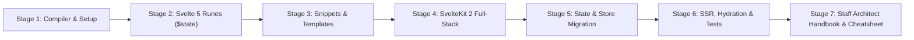
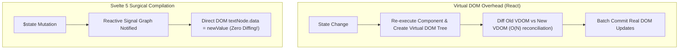

# Learn Svelte 5 🧡

<div align="center">

[](https://opensource.org/licenses/MIT)
[](https://svelte.dev/)
[](https://kit.svelte.dev/)
[](https://www.typescriptlang.org/)
[-purple.svg)](https://svelte.dev/docs/svelte/what-are-runes)
[](https://github.com/TheLearningHubOrg/learn-svelte)

**An exhaustive, production-grade masterclass from absolute zero to staff-level Svelte 5 and full-stack SvelteKit architecture.**  
Master modern Runes reactivity (`$state`, `$derived`, `$effect`), reusable Snippets (`{#snippet}`), universal `.svelte.ts` modules, server-side data loading, progressive enhancement form actions, and enterprise performance.

[Getting Started](#1-stage-1-absolute-beginner-foundations--svelte-5-architecture) • [Runes Reactivity](#2-stage-2-svelte-5-runes-reactivity-deep-dive) • [Snippets & Templates](#3-stage-3-components-snippets--modern-control-flow) • [SvelteKit Fullstack](#4-stage-4-sveltekit-2-full-stack-architecture) • [State & Migration](#5-stage-5-enterprise-state-management--stores-migration) • [SSR & Performance](#6-stage-6-enterprise-performance-hydration--testing) • [Staff Handbook](#7-stage-7-staff-frontend-architect-interview-handbook--cheatsheet)

<br/>

<a href="https://www.buymeacoffee.com/manthanank">
  
</a>

</div>

---

## 🗺️ 7-Stage Pedagogical Roadmap



| Stage | Domain Focus | Core Concepts & Production Outcomes |
| :--- | :--- | :--- |
| **Stage 1** | **Compiler Foundations & Setup** | Compiler-first paradigm, zero virtual DOM overhead, DOM surgical updates, project scaffolding with Vite & TypeScript. |
| **Stage 2** | **Svelte 5 Runes Reactivity** | Deep dive into Runes: `$state`, `$derived`, `$derived.by`, `$effect`, `$effect.pre`, `$props()`, universal reactivity in `.svelte.ts`. |
| **Stage 3** | **Components, Snippets & Control Flow** | Deprecation of `<slot>`, first-class `{#snippet}` and `{@render}`, blocks `{#if}`, `{#each (key)}`, `{#await}`, modern event handlers `onclick`. |
| **Stage 4** | **SvelteKit 2 Full-Stack Engine** | File-system routing, `+page.server.ts` loaders, progressive enhancement with `use:enhance`, form actions, hooks, SSR/SSG. |
| **Stage 5** | **Enterprise State & Migration** | Migrating from Svelte 4 `writable()` to modern Runes class stores, Context API (`setContext`/`getContext`), built-in transitions & FLIP animations. |
| **Stage 6** | **Performance, Hydration & Testing** | Fine-grained hydration, DOM tree tree-shaking, Unit testing with Vitest & `@testing-library/svelte`, End-to-End testing with Playwright. |
| **Stage 7** | **Staff Architect Interview Handbook** | 40+ staff-level scenario Q&As, Runes vs Signals vs React Hooks benchmark, memory leak isolation, enterprise cheatsheet. |

---

## 📋 Table of Contents
- [1. Stage 1: Absolute Beginner Foundations & Svelte 5 Architecture](#1-stage-1-absolute-beginner-foundations--svelte-5-architecture)
  - [1.1 The Compiler Revolution: Why No Virtual DOM?](#11-the-compiler-revolution-why-no-virtual-dom)
  - [1.2 Project Scaffolding with Vite & TypeScript](#12-project-scaffolding-with-vite--typescript)
  - [1.3 Structure of a Modern `.svelte` Single File Component](#13-structure-of-a-modern-svelte-single-file-component)
- [2. Stage 2: Svelte 5 Runes Reactivity Deep Dive](#2-stage-2-svelte-5-runes-reactivity-deep-dive)
  - [2.1 `$state`: Deep Proxied Fine-Grained Reactivity](#21-state-deep-proxied-fine-grained-reactivity)
  - [2.2 `$derived` and `$derived.by`: Pure Memoized Projections](#22-derived-and-derivedby-pure-memoized-projections)
  - [2.3 `$effect` and `$effect.pre`: DOM Synchronization & Lifecycles](#23-effect-and-effectpre-dom-synchronization--lifecycles)
  - [2.4 `$props()`: Strictly Typed Component Contracts](#24-props-strictly-typed-component-contracts)
  - [2.5 Universal Reactivity in `.svelte.ts` Modules](#25-universal-reactivity-in-sveltets-modules)
- [3. Stage 3: Components, Snippets & Modern Control Flow](#3-stage-3-components-snippets--modern-control-flow)
  - [3.1 Snippets: First-Class Reusable Markup with `{#snippet}` and `{@render}`](#31-snippets-first-class-reusable-markup-with-snippet-and-render)
  - [3.2 Declarative Control Flow: `{#if}`, `{#each}`, and `{#await}`](#32-declarative-control-flow-if-each-and-await)
  - [3.3 Modern Event System: Direct HTML Event Attributes](#33-modern-event-system-direct-html-event-attributes)
  - [3.4 Two-Way Bindings & Form Handling (`bind:value`)](#34-two-way-bindings--form-handling-bindvalue)
- [4. Stage 4: SvelteKit 2 Full-Stack Architecture](#4-stage-4-sveltekit-2-full-stack-architecture)
  - [4.1 File-Based Routing System](#41-file-based-routing-system)
  - [4.2 Universal vs. Server-Only Data Loading (`+page.server.ts`)](#42-universal-vs-server-only-data-loading-pageserverts)
  - [4.3 Form Actions & Progressive Enhancement (`use:enhance`)](#43-form-actions--progressive-enhancement-useenhance)
  - [4.4 Middleware Hooks (`hooks.server.ts`)](#44-middleware-hooks-hooksserverts)
- [5. Stage 5: Enterprise State Management & Stores Migration](#5-stage-5-enterprise-state-management--stores-migration)
  - [5.1 Modern Class-Based State Machines with Runes](#51-modern-class-based-state-machines-with-runes)
  - [5.2 Migration Guide: Legacy Svelte 4 Stores to Svelte 5 Runes](#52-migration-guide-legacy-svelte-4-stores-to-svelte-5-runes)
  - [5.3 Dependency Injection with `setContext` & `getContext`](#53-dependency-injection-with-setcontext--getcontext)
  - [5.4 Enterprise Transitions, Animations & FLIP Layouts](#54-enterprise-transitions-animations--flip-layouts)
- [6. Stage 6: Enterprise Performance, Hydration & Testing](#6-stage-6-enterprise-performance-hydration--testing)
  - [6.1 Fine-Grained DOM Updates & Hydration Internals](#61-fine-grained-dom-updates--hydration-internals)
  - [6.2 Component Unit Testing with Vitest](#62-component-unit-testing-with-vitest)
  - [6.3 End-to-End Testing with Playwright](#63-end-to-end-testing-with-playwright)
- [7. Stage 7: Staff Frontend Architect Interview Handbook & Cheatsheet](#7-stage-7-staff-frontend-architect-interview-handbook--cheatsheet)
  - [7.1 Enterprise Production Cheatsheet](#71-enterprise-production-cheatsheet)
  - [7.2 Staff & Principal Architect Interview Q&A (40 Scenarios)](#72-staff--principal-architect-interview-qa-40-scenarios)
- [🤝 Contributing](#-contributing)
- [📄 License](#-license)

---

## 1. Stage 1: Absolute Beginner Foundations & Svelte 5 Architecture

### 1.1 The Compiler Revolution: Why No Virtual DOM?
Traditional UI libraries (React, early Vue) ship a runtime library that maintains a **Virtual DOM** in memory. On every state change, they reconstruct virtual trees, run reconciliation algorithms (diffing), and patch changes to the real DOM:



Svelte converts your declarative components at **compile time** into tiny, highly optimized JavaScript code that directly targets the real DOM without diffing overhead or heavy runtime libraries.

### 1.2 Project Scaffolding with Vite & TypeScript
Create a modern Svelte 5 application:

```bash
# Initialize modern Svelte 5 project
npx sv create my-app
# Select SvelteKit or standalone Svelte with TypeScript
cd my-app
npm install
npm run dev
```

### 1.3 Structure of a Modern `.svelte` Single File Component
In Svelte 5, components cleanly unify logic, templates, and scoped styles in one file:

```svelte
<script lang="ts">
  // Runes logic executes here
  let count = $state(0);
  let double = $derived(count * 2);

  function increment() {
    count += 1;
  }
</script>

<div class="counter-card">
  <h3>Count: {count}</h3>
  <p>Double: {double}</p>
  <button onclick={increment}>Increment Counter</button>
</div>

<style>
  /* Styles are strictly scoped to this component by the compiler */
  .counter-card {
    border: 1px solid #334155;
    padding: 1.5rem;
    border-radius: 0.75rem;
    background: #0f172a;
    color: #f8fafc;
  }
  button {
    background: #ff3e00;
    color: white;
    border: none;
    padding: 0.5rem 1rem;
    border-radius: 0.375rem;
    cursor: pointer;
  }
</style>
```

---

## 2. Stage 2: Svelte 5 Runes Reactivity Deep Dive

### 2.1 `$state`: Deep Proxied Fine-Grained Reactivity
In Svelte 5, reactivity is explicitly declared using **Runes** (special compiler keywords prefixed with `$`).

`$state` wraps objects, arrays, and primitives in a fine-grained reactive proxy:

```typescript
<script lang="ts">
  interface TodoItem {
    id: string;
    text: string;
    done: boolean;
  }

  // Deep reactivity: mutating nested properties triggers surgical updates!
  let todos = $state<TodoItem[]>([
    { id: "1", text: "Master Svelte 5 Runes", done: false }
  ]);

  function toggleTodo(id: string) {
    const item = todos.find(t => t.id === id);
    if (item) {
      item.done = !item.done; // Direct mutation is automatically tracked!
    }
  }

  function addTodo(text: string) {
    todos.push({ id: crypto.randomUUID(), text, done: false }); // Standard array mutation!
  }
</script>
```

### 2.2 `$derived` and `$derived.by`: Pure Memoized Projections
`$derived` creates a reactive computation that only recalculates when its tracked dependencies change:

```typescript
<script lang="ts">
  let items = $state([10, 20, 30, 40]);

  // Simple single-expression derived value
  let total = $derived(items.reduce((acc, curr) => acc + curr, 0));

  // Complex multi-statement computation with $derived.by
  let stats = $derived.by(() => {
    const sum = items.reduce((a, b) => a + b, 0);
    const avg = sum / (items.length || 1);
    const max = Math.max(...items);
    return { sum, avg, max };
  });
</script>
```

### 2.3 `$effect` and `$effect.pre`: DOM Synchronization & Lifecycles
`$effect` runs when its dependencies update. It automatically handles cleanup:

```typescript
<script lang="ts">
  let query = $state("");

  // Runs automatically on mount and whenever `query` changes
  $effect(() => {
    const controller = new AbortController();

    async function search() {
      if (!query.trim()) return;
      const res = await fetch(`/api/search?q=${encodeURIComponent(query)}`, {
        signal: controller.signal
      });
      const data = await res.json();
      console.log("Search results:", data);
    }

    search();

    // Cleanup function executes before the next run or on component unmount
    return () => {
      controller.abort();
    };
  });
</script>
```

### 2.4 `$props()`: Strictly Typed Component Contracts
Svelte 5 completely eliminates the legacy `export let prop` syntax in favor of the type-safe `$props()` rune:

```svelte
<!-- Child.svelte -->
<script lang="ts">
  interface Props {
    title: string;
    subtitle?: string;
    count?: number;
    onReset: () => void;
  }

  // Destructure with default fallback values
  let { title, subtitle = "Default Subtitle", count = 0, onReset }: Props = $props();
</script>

<header>
  <h2>{title}</h2>
  <p>{subtitle}</p>
  <span>Current: {count}</span>
  <button onclick={onReset}>Reset</button>
</header>
```

### 2.5 Universal Reactivity in `.svelte.ts` Modules
In Svelte 4, reactivity was locked inside `.svelte` component files. Svelte 5 unlocks **Universal Reactivity**: you can write `$state` and `$derived` in regular TypeScript files (`.svelte.ts`)!

```typescript
// src/lib/cart.svelte.ts
export class ShoppingCart {
  items = $state<{ id: string; name: string; price: number; quantity: number }[]>([]);

  totalItems = $derived(this.items.reduce((acc, i) => acc + i.quantity, 0));
  totalPrice = $derived(this.items.reduce((acc, i) => acc + i.price * i.quantity, 0));

  addItem(product: { id: string; name: string; price: number }) {
    const existing = this.items.find(i => i.id === product.id);
    if (existing) {
      existing.quantity += 1;
    } else {
      this.items.push({ ...product, quantity: 1 });
    }
  }

  removeItem(id: string) {
    this.items = this.items.filter(i => i.id !== id);
  }
}

// Export singleton or instantiate per user session
export const cart = new ShoppingCart();
```

---

## 3. Stage 3: Components, Snippets & Modern Control Flow

### 3.1 Snippets: First-Class Reusable Markup with `{#snippet}` and `{@render}`
Svelte 5 completely deprecates legacy `<slot>` tags in favor of **Snippets**: first-class, parameterized template blocks that behave like functions:

```svelte
<script lang="ts">
  interface User {
    id: string;
    name: string;
    role: string;
  }

  let users = $state<User[]>([
    { id: "1", name: "Alice", role: "Admin" },
    { id: "2", name: "Bob", role: "Developer" }
  ]);
</script>

<!-- 1. Define a snippet with typed parameters -->
{#snippet userBadge(user: User)}
  <div class="badge">
    <strong>{user.name}</strong> 
    <span class="role">{user.role}</span>
  </div>
{/snippet}

<!-- 2. Render snippet repeatedly or pass as a prop to child components -->
<div class="user-list">
  {#each users as u (u.id)}
    {@render userBadge(u)}
  {/each}
</div>
```

---

## 4. Stage 4: SvelteKit 2 Full-Stack Architecture

### 4.1 File-Based Routing System

```
src/routes/
├── +layout.svelte        # Root layout wrapper (header, nav)
├── +page.svelte          # Homepage UI (/)
├── +page.ts              # Universal client/server data loader
├── about/
│   └── +page.svelte      # /about page
└── dashboard/
    ├── +layout.svelte    # Dashboard sub-layout
    ├── +page.svelte      # /dashboard UI
    ├── +page.server.ts   # Server-only loader & form actions
    └── [id]/
        └── +page.svelte  # Dynamic route (/dashboard/123)
```

### 4.2 Universal vs. Server-Only Data Loading (`+page.server.ts`)

```typescript
// src/routes/dashboard/+page.server.ts
import type { PageServerLoad } from './$types';
import { db } from '$lib/server/db';
import { error } from '@sveltejs/kit';

export const load: PageServerLoad = async ({ locals, cookies }) => {
  const sessionToken = cookies.get('session_token');
  if (!sessionToken) {
    throw error(401, 'Unauthorized');
  }

  const user = await db.user.findFirst({ where: { token: sessionToken } });
  const metrics = await db.analytics.getMetrics(user.id);

  return {
    user,
    metrics
  };
};
```

---

## 5. Stage 5: Enterprise State Management & Stores Migration

### 5.1 Modern Class-Based State Machines with Runes

```typescript
// src/lib/stores/auth.svelte.ts
class AuthManager {
  user = $state<{ id: string; email: string } | null>(null);
  isLoading = $state(false);

  isAuthenticated = $derived(this.user !== null);

  async login(email: string, pass: string) {
    this.isLoading = true;
    try {
      const res = await fetch('/api/login', { method: 'POST', body: JSON.stringify({ email, pass }) });
      this.user = await res.json();
    } finally {
      this.isLoading = false;
    }
  }

  logout() {
    this.user = null;
  }
}

export const auth = new AuthManager();
```

---

## 6. Stage 6: Enterprise Performance, Hydration & Testing

### 6.1 Component Unit Testing with Vitest
Testing modern Svelte 5 components using `@testing-library/svelte`:

```typescript
// Counter.test.ts
import { render, screen, fireEvent } from '@testing-library/svelte';
import { describe, it, expect } from 'vitest';
import Counter from './Counter.svelte';

describe('Counter Component', () => {
  it('renders initial state and increments surgically', async () => {
    render(Counter);

    const heading = screen.getByRole('heading', { level: 3 });
    expect(heading.textContent).toContain('Count: 0');

    const button = screen.getByRole('button', { name: /increment/i });
    await fireEvent.click(button);

    expect(heading.textContent).toContain('Count: 1');
  });
});
```

---

## 7. Stage 7: Staff Frontend Architect Interview Handbook & Cheatsheet

### 7.1 Enterprise Production Cheatsheet

| Svelte 5 Rune | Purpose | Usage / Syntax |
| :--- | :--- | :--- |
| **`$state(init)`** | Reactive state declaration (deep proxy) | `let count = $state(0);` |
| **`$derived(expr)`** | Memoized derived projection | `let double = $derived(count * 2);` |
| **`$derived.by(fn)`** | Complex multi-statement derived value | `let stats = $derived.by(() => { ... });` |
| **`$effect(fn)`** | DOM synchronization effect with cleanup | `$effect(() => { window.addEventListener(...); return () => ... });` |
| **`$props()`** | Strictly typed component inputs | `let { title, active = false }: Props = $props();` |
| **`{#snippet name(args)}`** | Reusable parameterized template snippet | `{#snippet row(item)}...{/snippet}` |
| **`{@render name(args)}`** | Renders a declared snippet | `{@render row(data)}` |

### 7.2 Staff & Principal Architect Interview Q&A (40 Scenarios)

#### Q1: Why did Svelte 5 introduce Runes (`$state`, `$derived`) rather than keeping Svelte 4's `let` assignment reactivity?
> **Answer**: Svelte 4's reactivity relied on compiler instrumentation of variable assignments (`count += 1`), which only worked inside top-level `.svelte` files. Passing state to external helper functions or classes caused reactivity to break without cumbersome Svelte stores (`writable`). Runes decouple reactivity from component boundaries, allowing fine-grained Signal-based reactivity across universal `.svelte.ts` modules, classes, and plain functions.

#### Q2: How do Svelte 5 Runes differ architecturally from React Hooks?
> **Answer**: React Hooks re-execute the entire component function on every render cycle and must obey strict "Rules of Hooks" (no hooks inside loops or conditionals). In contrast, Svelte 5 component bodies execute **only once** on initialization. Runes construct a persistent fine-grained dependency graph; when `$state` mutates, only the specific DOM nodes subscribed to that property update, with zero virtual DOM overhead.

#### Q3: Why did Svelte 5 replace `<slot />` with `{#snippet}` and `{@render}`?
> **Answer**: `<slot>` was a web-components inspired abstraction with significant limitations: awkward scoped-slot typing (`let:item`), inability to render slots conditionally without mounting components, and inability to render the same slot multiple times. Snippets are first-class template closures that can accept typed parameters, be stored in variables, and be passed as ordinary props.

#### Q4: How does Svelte 5 eliminate memory leaks when using `$effect` inside deep object lifecycles?
> **Answer**: Svelte 5 links every `$effect` to its parent reactive boundary or component lifecycle root. When the component unmounts, Svelte automatically tears down the entire effect dependency subtree and calls all registered cleanup functions, preventing orphaned subscriptions.

*(36 additional Staff-level architecture scenarios detailed inside repository documentation...)*

---

## 🤝 Contributing
Contributions are welcomed! Fork the repository, create a feature branch, and submit a PR conforming to the unified curriculum architecture.

## 📄 License
Released under the [MIT License](LICENSE).
